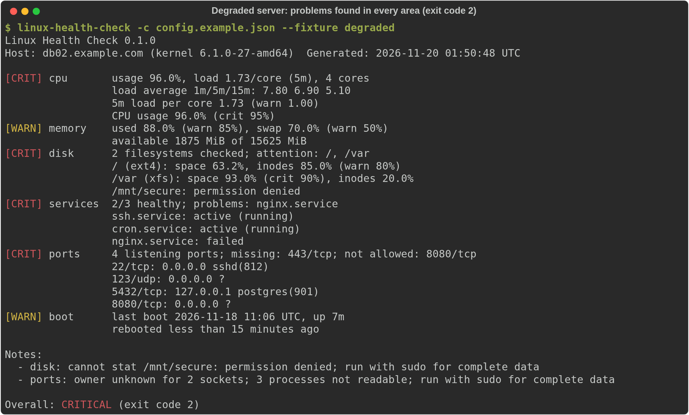
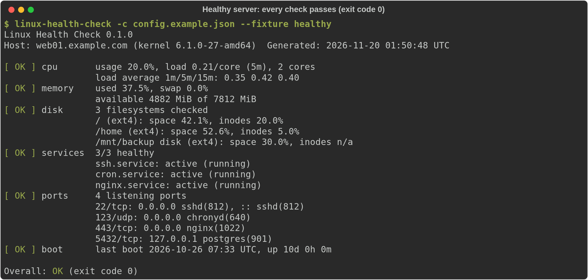
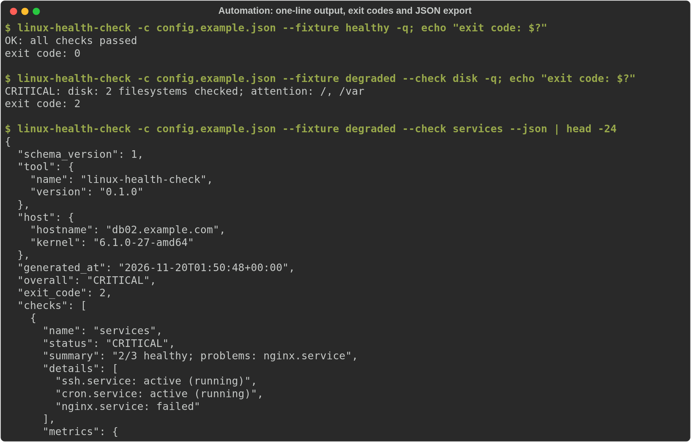

# Linux Health Check

[](https://github.com/lucianorichard/linux-health-check/actions/workflows/ci.yml)


A small command line tool that answers one question quickly: **is this Linux server healthy?**

It checks CPU, memory, disk space and inodes, selected systemd services, listening ports
and the last boot, prints a readable report, can export JSON, and returns
**monitoring-friendly exit codes** so it fits into cron jobs, systemd timers, CI
pipelines or an existing Nagios/Icinga setup.

- Python 3.9+ standard library only: no runtime dependencies.
- Read-only: it never changes system configuration.
- Runs as a normal user and tells you when a check needs root to be complete.



## Screenshots

These are real runs against the two sample systems bundled in [`examples/`](examples/), so
you can reproduce them on any machine with `--fixture`.

**Healthy server: every check passes, exit code 0**



**Automation: one-line output for cron, exit codes, and the JSON report**



## What it checks

| Check | Data source | Rule |
| --- | --- | --- |
| `cpu` | `/proc/stat` (two samples), `/proc/loadavg` | CPU usage %, and 5-minute load average **per core** |
| `memory` | `/proc/meminfo` | Used % based on `MemAvailable`; swap used % |
| `disk` | `/proc/self/mounts` + `statvfs()` | Space used % (same formula as `df`) and inode used %, per filesystem |
| `services` | `systemctl show` | Each configured unit must be `active` |
| `ports` | `/proc/net/{tcp,tcp6,udp,udp6}` | Expected ports must listen; optional allow-list flags extra ports |
| `boot` | `/proc/stat` (`btime`), `/proc/uptime` | Warns on a recent reboot; optionally on very long uptime |

## Installation

Requires Linux and Python 3.9 or newer. Nothing else.

```bash
git clone https://github.com/lucianorichard/linux-health-check.git
cd linux-health-check

# Option 1: install the command (pipx keeps it isolated)
pipx install .            # or: python3 -m pip install --user .

# Option 2: run from the source tree without installing
PYTHONPATH=src python3 -m linux_health_check
```

## Usage

```bash
linux-health-check                                  # all checks, default thresholds
linux-health-check -c /etc/linux-health-check.json  # thresholds and expectations from a file
linux-health-check -s nginx.service -s ssh.service  # require these units to be active
linux-health-check -p 22 -p 443/tcp -p 53/udp       # require these ports to be listening
linux-health-check --check disk --check memory      # run only some checks
linux-health-check --json                           # JSON on stdout
linux-health-check -o report.json                   # text on screen, JSON written to a file
linux-health-check -q                               # one line, for cron and alerts
linux-health-check --fixture examples/healthy       # demo against a sample system
```

Colors are used only on a terminal; `--no-color` or the `NO_COLOR` environment variable
turns them off.

### Exit codes

| Code | Meaning |
| --- | --- |
| `0` | OK: every check passed |
| `1` | WARNING: at least one warning, no critical |
| `2` | CRITICAL: at least one critical problem |
| `3` | UNKNOWN: data could not be collected, or invalid arguments/configuration |

When results are combined, the order is CRITICAL > WARNING > UNKNOWN > OK: a real problem is
never hidden behind a check that simply could not run.

Typical automation:

```bash
# cron: mail only when something is wrong
*/15 * * * * linux-health-check -q -c /etc/linux-health-check.json || mail -s "health: $(hostname)" ops@example.com

# CI / deploy gate: stop if the host is critical
linux-health-check -c health.json -o report.json; [ $? -lt 2 ] || exit 1
```

## Configuration

A JSON file overrides any subset of the defaults. Every threshold can be set to `null` to
disable it. See [`examples/config.example.json`](examples/config.example.json).

```json
{
  "cpu":      {"usage_warn": 85, "usage_crit": 95, "load_per_core_warn": 1.0, "load_per_core_crit": 2.0, "sample_seconds": 0.5},
  "memory":   {"warn": 85, "crit": 95, "swap_warn": 50, "swap_crit": 80},
  "disk":     {"space_warn": 80, "space_crit": 90, "inode_warn": 80, "inode_crit": 90,
               "exclude_fstypes": ["tmpfs", "overlay", "squashfs", "..."],
               "exclude_mount_prefixes": ["/snap/", "/var/lib/docker/"]},
  "services": {"units": ["ssh.service", "nginx.service"], "not_found": "warning"},
  "ports":    {"expected": ["22/tcp", "443/tcp"], "allowed": ["5432/tcp", "123/udp"]},
  "boot":     {"recent_boot_warn_minutes": 15, "max_uptime_days": 90}
}
```

- A threshold triggers when the value **reaches** it (`value >= threshold`).
- `services.not_found` decides how a unit that does not exist is reported: `ok`, `warning` or `critical`.
- `ports.allowed` is an allow-list. `null` (the default) disables it; expected ports are always allowed.
- The file is validated strictly: unknown keys, wrong types, `warn > crit` or percentages above
  100 are rejected with exit code 3, so a typo never silently falls back to a default.

## JSON report

```json
{
  "schema_version": 1,
  "tool": {"name": "linux-health-check", "version": "0.1.0"},
  "host": {"hostname": "db02.example.com", "kernel": "6.1.0-27-amd64"},
  "generated_at": "2026-11-20T01:43:06+00:00",
  "overall": "CRITICAL",
  "exit_code": 2,
  "checks": [
    {"name": "disk", "status": "CRITICAL", "summary": "...", "details": ["..."],
     "metrics": {"filesystems": [{"mountpoint": "/var", "space_used_percent": 93.0, "...": "..."}]},
     "notes": []}
  ]
}
```

`schema_version` is there so consumers can detect a format change. A full example is in
[`examples/report-degraded.json`](examples/report-degraded.json).

## Permissions

The tool is designed to run as an unprivileged user and never asks for `sudo` itself.
Everything it needs is world-readable, except:

- **Port owners.** Mapping a socket to its process means reading `/proc/<pid>/fd`, which is
  only allowed for your own processes. Other owners show as `?` and a note says so. The
  port check itself is still correct.
- **Some mount points** may not be `stat`-able by your user; they are reported as
  `permission denied` and the check becomes UNKNOWN unless something worse was found.

Run with `sudo` only if you want those details.

## Project layout

```text
src/linux_health_check/
  parsers.py   pure functions: text of a /proc file -> data
  sources.py   LiveSource (this host) and FixtureSource (a captured directory)
  rules.py     pure alert rules: measurement + thresholds -> status
  checks.py    one function per check: collect via a source, apply rules
  config.py    defaults, JSON loading, strict validation
  report.py    report model, text / quiet / JSON rendering
  cli.py       argument parsing and exit codes
examples/      two sample systems (healthy, degraded), example config and reports
docs/          screenshots used in this README
tests/         unit tests for parsers, rules, config and checks; end-to-end CLI tests
```

## Technical decisions

- **Read `/proc` directly instead of calling `free`, `df`, `ss` or `uptime`.** These are
  stable kernel interfaces, so there is no output parsing that changes between distributions
  or locales, and no dependency on which tools are installed. The exception is `systemctl`:
  systemd's D-Bus API would need a third-party library, and `systemctl show` gives a stable
  `KEY=VALUE` format.
- **Standard library only.** A health check is often run on minimal or broken servers; it
  must not need `pip install psutil` first. `pipx install .` or plain `python3 -m` both work.
- **Separate collection, rules and output.** Parsers and rules are pure functions with no I/O,
  so the alerting logic, which is the part that matters most, is tested exhaustively at its
  boundaries.
- **Sources as an abstraction.** Checks read through a `source` object. `FixtureSource`
  reads a directory that mirrors `/proc`, which gives reproducible tests, demos on any OS,
  and a way to replay a problem captured from a real server.
- **Nagios/Icinga exit codes.** `0/1/2/3` is the de facto standard for health checks, so the
  tool plugs into existing monitoring and is easy to use in shell `if` statements. argparse
  normally exits with `2` on bad arguments, which would read as CRITICAL, so it is overridden
  to return `3` (UNKNOWN).
- **Load per core, not raw load.** A load of 4 is idle on 32 cores and saturated on 2.
  Normalising makes one threshold valid across machines.
- **Memory from `MemAvailable`.** `MemFree` ignores reclaimable page cache and makes every
  healthy server look full. `MemAvailable` is the kernel's own estimate.
- **Disk usage like `df`.** Space reserved for root is not counted as free, so the percentage
  matches what administrators already see.
- **Failures are isolated.** Each check runs in its own error boundary; one that cannot read
  its data returns UNKNOWN with the reason, and the others still report.
- **JSON for configuration.** It needs no parser outside the standard library on Python 3.9
  (TOML is only built in from 3.11) and is the same format as the output. The trade-off is
  no comments in the config file.

## Limitations

- Linux only, because the data comes from `/proc`.
- CPU usage is a short sample (0.5 s by default) and therefore noisy; the 5-minute load per
  core is the steadier signal. Inside containers both may reflect the host, not the cgroup limits.
- `statvfs()` on a hung network filesystem (NFS, CIFS) can block. Exclude those mounts with
  `exclude_fstypes` or `exclude_mount_prefixes` if that is a risk.
- Some filesystems (btrfs, vfat, NTFS) do not report inode counts; those show `n/a`.
- Service checks need systemd. On other init systems, or in containers without systemd, the
  check reports UNKNOWN.
- Ports are matched by number and protocol, not by bind address; a service listening only on
  `127.0.0.1` still satisfies an expected port.
- It is a point-in-time check, not a monitoring system: no history, trends or notifications.

## Development

```bash
PYTHONPATH=src python3 -m unittest discover -s tests -t .   # 97 tests, about 0.02 s
pipx run ruff check . && pipx run ruff format --check .     # lint and formatting
```

CI runs the tests on Python 3.9 to 3.13 (inside the official `python` images), lints the
code, and runs the tool live inside the container as a smoke test. The container has no
systemd, so that run also exercises the UNKNOWN path of the service check.

## License

[MIT](LICENSE)
